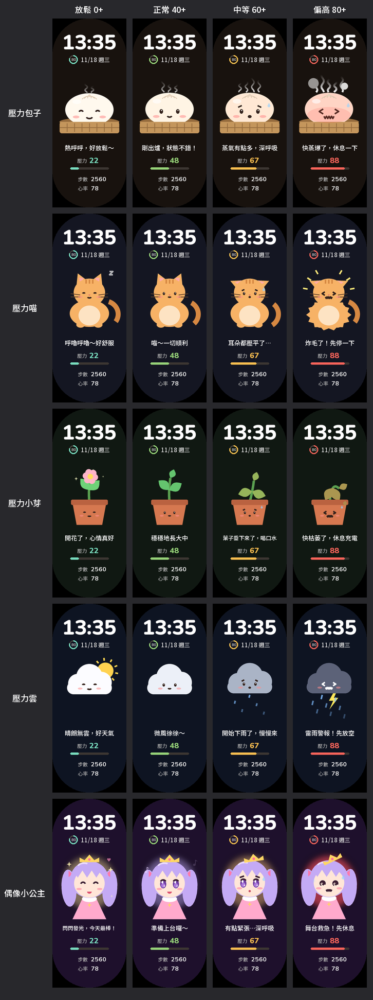
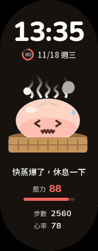
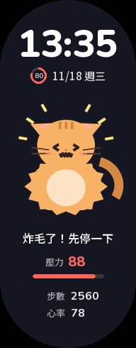
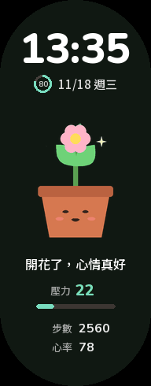
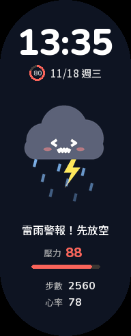
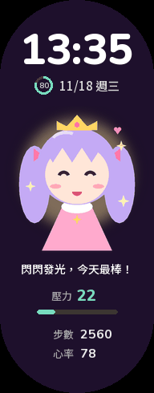
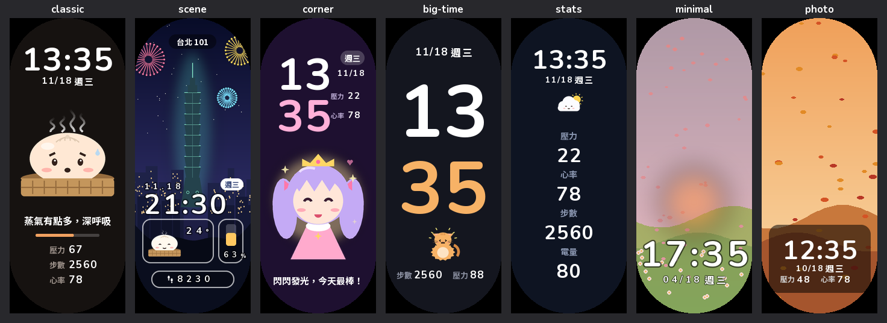
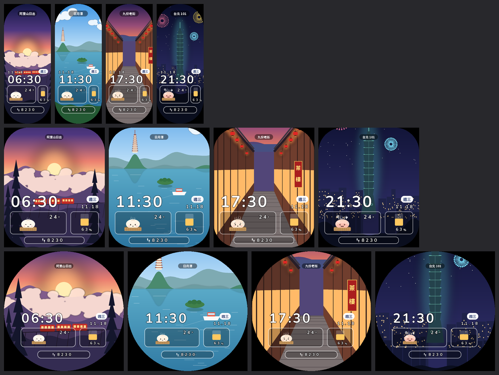

# moodface


[](https://pepy.tech/projects/moodface)
[](https://github.com/changyy/py-moodface/actions/workflows/test.yml)

Animated watch faces for Xiaomi smart bands and watches that react to your all-day stress level — the character, background and caption change as your stress goes up or down. The same rules drive faces that follow the time of day, the season, the weekday, battery or heart rate.



| Bun | Cat | Sprout | Cloud | Idol |
|:---:|:---:|:---:|:---:|:---:|
|  |  |  |  |  |
| steams up under stress | fur puffs up | blooms when calm | storms when stressed | sparkles when calm |

> **Status: alpha.** Faces build for 16 bands and watches; testing on real devices is still in progress.

## Features

- 😌 **Stress-driven** — four stress levels, each with its own picture, animation and caption
- 🌸 **Rules** — switch by `season`, `time_of_day`, `weekday`, battery, heart rate, any threshold or range (`"22-5"` wraps past midnight)
- 🧱 **Layouts** — `classic`, `scene`, `corner`, `big-time`, `stats`, `minimal`, `photo`; one `face.yaml` fits bands, square and round watches
- 🔢 **Generated text** — time, dates, weekday badges, labels and Traditional Chinese captions rendered from OFL fonts
- 🎞️ **Previews** — GIFs for every state, a simulated day and year, before you build anything
- 📄 **Declarative** — a `face.yaml` plus PNGs; `moodface validate` catches problems early

## Installation

```bash
pip install moodface
```

Previews need nothing else. Building a `.bin` also needs Docker (Docker Desktop on macOS / Windows) and a third-party compiler (see [Third-party](#third-party)), which always runs inside a container so it never touches your system:

```bash
moodface compiler setup        # asks before downloading
moodface compiler status
```

## Quick start

```bash
EX=$(python -c "import moodface, pathlib; print(pathlib.Path(moodface.__file__).parent / 'examples')")
moodface preview $EX/classic_bun -o bun_preview     # overview.png, stress_*.gif, day.gif
moodface build $EX/classic_bun -o bun_build         # bun_build/classic_bun.bin
moodface build $EX/classic_bun --device watchs4     # the same face for a round watch
```

A face is a folder with a `face.yaml` and its pictures:

```yaml
name: my_bun
device: band9                     # moodface devices
layout: classic                   # moodface layouts
slots:
  character:
    source: stress_level          # calm / normal / medium / high
    images: {calm: assets/calm.png, normal: assets/normal.png, medium: assets/medium.png, high: assets/high.png}
  caption:
    texts: {calm: 熱呼呼，好放鬆～, normal: 剛出爐，狀態不錯！, medium: 蒸氣有點多，深呼吸, high: 快蒸爆了，休息一下}
  stats: [stress, steps, heart_rate]
```



Layouts, rules, widgets, the device list and all examples are in the **[reference](https://github.com/changyy/py-moodface/blob/main/docs/reference.md)**.

## A day around Taiwan

The `taiwan_scenes` example fills the screen with a scene that follows the hour — Alishan sunrise, Sun Moon Lake, Jiufen and Taipei 101 — with the steamed bun showing your stress in the card:



## Draw your own character

[`examples/draw_bun.py`](https://github.com/changyy/py-moodface/blob/main/examples/draw_bun.py) is a self-contained example (Pillow only) that draws the bun in four moods and writes a `face.yaml`:

```bash
python examples/draw_bun.py my_bun
moodface preview my_bun
moodface build my_bun
```

Replace `draw_bun()` with your own drawing — or any PNGs with the same names — and moodface handles the layout, digits, captions and switching.

Install the resulting `.bin` with a tool that supports custom watch faces for your device.

## Use with Claude Code

```bash
moodface init --workspace my_faces     # or `moodface init` in the current folder
cd my_faces && claude
```

`init` adds a `moodface` skill (`.claude/skills/moodface/SKILL.md`), a short `CLAUDE.md`, the `Dockerfile` the compiler runs in, and an example face, so you can ask Claude Code for a face in plain words — it writes the `face.yaml`, draws the pictures, checks the previews and builds the `.bin`. Use `--device watchs4` (or any key from `moodface devices`) to set the default device.

## Development

```bash
pip install -e .
python -m unittest discover -s tests -v
```

The version lives in [`src/moodface/_version.py`](https://github.com/changyy/py-moodface/blob/main/src/moodface/_version.py) and follows `1.YYYYmmdd.1HHmmss`. Bump it, commit, and publish a GitHub Release with the same tag; the `Upload Python Package` workflow tests, builds and publishes to PyPI.

## Third-party

- **Compiler** — `.bin` files are produced by `compile.exe`, a closed-source compiler distributed with [Mi Create](https://github.com/ooflet/Mi-Create). moodface downloads it only when you run `moodface compiler setup`, runs it in a Docker container and never redistributes it.
- **Fonts** — no fonts ship with moodface. [Nunito](https://github.com/googlefonts/nunito) and [Noto Sans TC](https://github.com/notofonts/noto-cjk) (SIL Open Font License) are downloaded from Google Fonts on first use (`moodface fonts setup`), or pass your own with `--font` / `--text-font`.

## Artwork and disclaimer

The characters and scenes in the examples are original artwork made for this project and ship as PNG files under the MIT license; no photos or third-party characters are used. moodface is an unofficial project, not affiliated with or endorsed by Xiaomi. Installing custom watch faces is at your own risk.

## License

MIT
