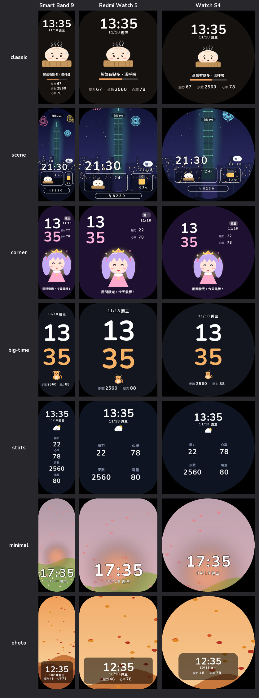
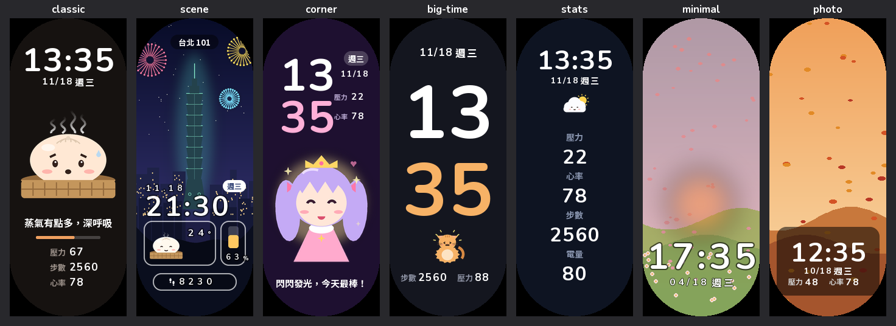
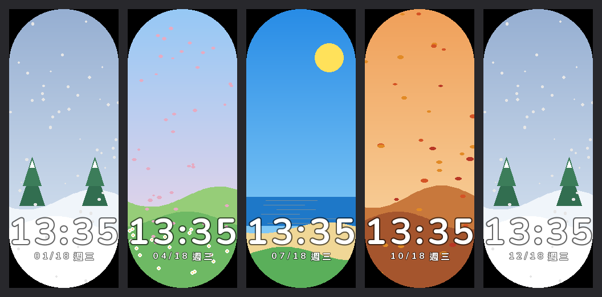
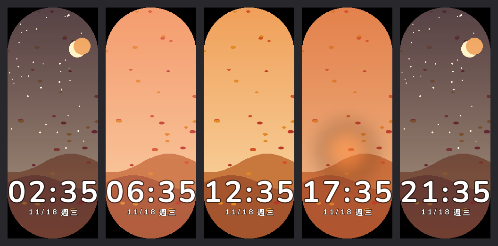
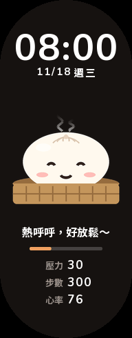

# moodface reference

Everything beyond the [README](../README.md): commands, devices, layouts, rules, widgets and examples.

- [Commands](#commands)
- [How a face is built](#how-a-face-is-built)
- [Devices](#devices)
- [Layouts](#layouts)
- [Rules](#rules)
- [Widgets](#widgets)
- [Examples](#examples)
- [Compiler](#compiler)

## Commands

```bash
moodface devices [--shape band|square|round]       # device profiles
moodface layouts [-v]                              # built-in layouts (and their slots)
moodface rules                                     # rule sources and key syntax
moodface sources [--device band9]                  # data sources a widget can bind to
moodface validate my_face/                         # check face.yaml and its images
moodface preview my_face/ [--vary hour ...]        # → my_face/preview/: overview.png, <source>_*.gif, day.gif
moodface build my_face/ [--device watchs4]         # → my_face/build/my_face.bin
moodface build my_face/ --id 123456789             # or --id time / --id-length 12; overrides id / id_length in face.yaml
moodface build my_face/ --width 220 --height 540 --radius 110 --device-type 999 --shape band   # custom model
moodface compiler setup | status | docker-build
moodface fonts setup                               # download Nunito + Noto Sans TC ahead of time
moodface preview my_face/ --font my.ttf --text-font my_cjk.ttf   # use your own (licensed) fonts
```

`python -m moodface ...` works too. The bundled examples live inside the package:

```bash
EX=$(python -c "import moodface, pathlib; print(pathlib.Path(moodface.__file__).parent / 'examples')")
```

## How a face is built

```
face.yaml + PNG assets  ──►  layout + rules expanded into widgets  ──►  .fprj project  ──►  compiler  ──►  .bin
```

A face is a folder with a `face.yaml` and its PNG assets. Widgets bind to the device's own data sources, e.g. `stress` (`0826`, 0–100), `heart_rate`, `steps` and `battery`; an image list keyed by thresholds swaps the artwork. `moodface preview` renders the same widgets on your computer, so you can check every state before building.

### Face id

Every face has an id, 9–12 digits not starting with 0. By default it is derived from `name` (9 digits; `id_length: 12` for 12), so rebuilding a face keeps its id and different faces get different ids. `id: 123456789` in face.yaml or `moodface build --id` sets it explicitly; `id: time` (or `--id time`) uses the build time instead, `yyMMddHHmmss` (e.g. `261119213045`), so every build gets a new id. `validate` and `build` print it.

The band refuses to install a face whose id is already installed, even if the content changed: to update a face, remove the old one from the band first, or give the new build another id (`id: time` does that on every build; old builds then stay on the band until removed).

## Devices

Bands, square watches and round watches share the same data sources (stress is `0826` everywhere), so one `face.yaml` builds for all of them; layouts switch to a variant per screen shape.



"Compiles" means the compiler produced a `.bin`; it does **not** mean the face was tested on that device.

| Device | Key | Shape | DeviceType | Screen | Compiles |
|---|---|---|---|---|---|
| Xiaomi Smart Band 7 Pro | `band7pro` | band | 6 | 280×456 | ✅ |
| Xiaomi Smart Band 8 | `band8` | band | 9 | 192×490 | ✅ |
| Xiaomi Smart Band 8 Pro | `band8pro` | band | 11 | 336×480 | ✅ |
| Xiaomi Smart Band 9 | `band9` | band | 366 | 192×490 | ✅ |
| Xiaomi Smart Band 9 Pro | `band9pro` | band | 367 | 336×480 | ✅ |
| Xiaomi Smart Band 10 | `band10` | band | 466 | 212×520 | ✅ output is uncompressed (~2 MB) |
| Xiaomi Smart Band 11 | `band11` | band | 466 | 212×520 | ✅ same build as Band 10; output is uncompressed (~2–3 MB) |
| Redmi Smart Band Pro | `redmibandpro` | band | 8 | 194×368 | ✅ output is uncompressed |
| Redmi Watch / POCO Watch | `redmiwatch` | square | 5 | 320×360 | ✅ output is uncompressed |
| Redmi Watch 2 Lite | `redmiwatch2lite` | square | 10 | 320×360 | ✅ output is uncompressed |
| Redmi Watch 3 | `redmiwatch3` | square | 7 | 390×450 | ✅ |
| Redmi Watch 3 Active | `redmiwatch3active` | square | 12 | 240×280 | ❌ compiler error |
| Redmi Watch 4 | `redmiwatch4` | square | 365 | 390×450 | ✅ |
| Redmi Watch 5 | `redmiwatch5` | square | 465 | 432×514 | ✅ |
| Redmi Watch 5 Active | `redmiwatch5active` | square | 3651 | 320×385 | ❌ needs a newer compiler |
| Redmi Watch 5 Lite | `redmiwatch5lite` | square | 3652 | 410×502 | ❌ needs a newer compiler |
| Xiaomi Watch S1 / S2 / Watch 2 | `watchs1` | round | 3 | 466×466 | ✅ output is uncompressed (~2 MB) |
| Xiaomi Watch S1 Pro | `watchs1pro` | round | 4 | 480×480 | ✅ output is uncompressed (~2 MB) |
| Xiaomi Watch S3 | `watchs3` | round | 362 | 466×466 | ✅ |
| Xiaomi Watch S4 | `watchs4` | round | 462 | 466×466 | ✅ |

❌ means the compiler itself (`compile.exe` v4.22 from Mi Create) rejects the project for that model — the same face compiles for every other device. A newer compiler release may support these models; point `MOODFACE_COMPILER` at it to try.

**Band 11** uses the same screen size and build settings as Band 10. Its faces are uncompressed and fairly large (a full-screen photo face is about 3 MB), so they take a little longer to install.

Legacy models with another data-source scheme (Xiaomi Watch Color, 70mai Saphir) and the original Smart Band 7 are not supported. Draw full-screen artwork for the largest screen you target; `fit: cover` crops it for the others.

## Layouts



A layout face fills slots instead of placing widgets by hand. Positions are percentages, so the same `face.yaml` builds for a 192×490 band, a 432×514 square watch or a 466×466 round watch.

```yaml
name: classic_bun
device: band9
background: "#161210"
layout: classic
style: {accent: "#F0A060", muted: "#9A8F88"}   # font, text_font, color, muted, accent, weight, stroke
slots:
  character:                      # art slot: a picture, an image list, an animation or layers
    source: stress_level
    images: {calm: assets/calm.png, normal: assets/normal.png, medium: assets/medium.png, high: assets/high.png}
  caption:                        # text per level, rendered with Noto Sans TC
    texts: {calm: 熱呼呼，好放鬆～, normal: 剛出爐，狀態不錯！, medium: 蒸氣有點多，深呼吸, high: 快蒸爆了，休息一下}
  bar: {}                         # progress bar for stress (enable an optional slot with {})
  stats: [stress, steps, heart_rate]
  date: {format: "MM/DD 週W"}      # tokens: YYYY MM DD W (日..六) WWW (Sun..Sat)
```

Layouts differ mainly in where the time goes: centered on top (`classic`, `stats`), lower left beside a weekday badge (`scene`), stacked in the top-left corner (`corner`), stacked large in the middle (`big-time`) or near the bottom of a full-screen picture (`minimal`, `photo`).

| Slot kind | What it draws | Common keys |
|---|---|---|
| `art` | picture, image list, animation, or a list of layers | `image`, `images` + `source`, `frames`, `box`, `fit` |
| `time` | digits from a format | `format` (`HH:MM`, `HH`, `MM`), `size`, `color`, `spacing` |
| `date` | date and weekday | `format` (`MM/DD 週W`, `MM.DD`, `WWW DD`) |
| `weekday` | weekday tag, optionally on a badge | `prefix` (`週`), `lang` (`zh`, `en`), `bg`, `pad`, `radius`, `outline` |
| `caption` | text chosen by a source | `texts`, `source` (default `stress_level`), `bg` |
| `bar` | progress bar | `source`, `max`, `w`, `h`, `direction` (`right`, `up`), `color`, `track` |
| `stats` | labelled values | `items`, `arrange` (`rows`, `grid`, `inline`), `card` |
| `panel` | rounded box, optionally outlined | `box`, `fill`, `radius`, `outline`, `outline_width` |
| `text` | static text | `text`, `size`, `bg` |

`stats` items are a source name or a mapping: `{source: steps, icon: assets/shoe.png}` puts an icon in place of the label, `{source: temp_c, label: "", unit: "°"}` shows just the value with a unit, and `card: {fill: "#FFFFFF33", outline: "#FFFFFF88", radius: 10}` draws a box behind each item.

Set a slot to `false` to hide it, or add your own slot with a `kind:`. Every text slot accepts `stroke` (outline width) so it stays readable on bright pictures. Each layout has a variant for `square` and `round` screens, and a face can adjust per shape too:

```yaml
layout: classic
slots:
  stats: [stress, steps, heart_rate]
variants:
  round:                       # only on round watches
    style: {accent: "#80D0FF"}
    slots:
      stats: [stress, heart_rate]
      caption: false
```

## Rules

An image list (or caption) maps keys to pictures (or texts). Keys can be thresholds, ranges or named keys of a rule source:

```yaml
- type: imagelist
  source: season             # month → spring / summer / autumn / winter
  hemisphere: south          # flips the seasons
  images: {spring: spring.png, summer: summer.png, autumn: autumn.png, winter: winter.png}

- type: imagelist
  source: hour
  images: {"22-5": sleep.png}  # wraps past midnight; other hours show nothing

- type: imagelist
  source: stress_level
  boundaries: {calm: 0, normal: 35, medium: 55, high: 75}   # move the bands
  images: {calm: a.png, normal: b.png, medium: c.png, high: d.png}
```

| Rule source | Real source | Keys |
|---|---|---|
| `season` | month | spring 3–5, summer 6–8, autumn 9–11, winter 12–2 |
| `time_of_day` | hour | night 19–4, dawn 5–7, day 8–16, dusk 17–18 |
| `weekday` | week | sun … sat |
| `weekpart` | week | weekday 1–5, weekend 0 + 6 |
| `stress_level` | stress | calm 0–39, normal 40–59, medium 60–79, high 80–100 |
| `battery_level` | battery | low 0–19, mid 20–59, high 60–100 |
| `hr_level` | heart_rate | rest <70, normal 70–99, active 100–139, high 140+ |

Layers combine rules: the `four_seasons` example puts a season background under a translucent time-of-day overlay, so 4 + 4 pictures cover 16 combinations.

| By month (`season`) | By hour (`time_of_day`) |
|:---:|:---:|
|  |  |

## Widgets

Layouts expand into low-level widgets, which you can also write directly in `widgets:` (drawn on top of the layout):

```yaml
widgets:
  - {type: image, image: assets/frame.png}
  - {type: image, fill: "#00000080", w: 80%, h: 60, x: 10%, y: 70%, radius: 12}
  - {type: text, text: 今天也要加油, x: 50%, y: 60%, anchor: center, size: 3%}
  - {type: number, source: steps, digits: 5, x: 50%, y: 85%, anchor: top, size: 5%}          # generated digits
  - {type: number, source: hour, digits: 2, x: 36, y: 40, images: assets/digits/{n}.png}     # your own digits
  - {type: imagelist, source: weekpart, texts: {weekday: 上班日, weekend: 週末}, x: 50%, y: 8%, anchor: top}
  - {type: bar, source: battery, w: 60%, h: 6, x: 50%, y: 92%, anchor: center, steps: 10}
  - {type: animation, frames: assets/sparkle/*.png, interval_ms: 120, box: [0, 30%, 100%, 30%], fit: contain}
```

- Positions: pixels or `"50%"`; `anchor` (`top-left`, `top`, `center`, `bottom-right`, …) picks the point placed at `x, y`
- `box: [x, y, w, h]` + `fit: contain | cover | stretch` scales pictures of any size into a frame
- `moodface validate` checks image sizes in each list, screen bounds, round-screen clipping, data sources per device and total asset size

## Examples

| Example | Layout | Switches on |
|---|---|---|
| `stress_test` | widgets | stress (labelled A–D backgrounds, to verify the basics on a device) |
| `classic_bun` | classic | stress level: steamed bun, caption, bar |
| `taiwan_scenes` | scene (full bleed) | hour: Alishan sunrise, Sun Moon Lake, Jiufen, Taipei 101; stress-level bun card |
| `scene_winter` | scene | season scene; stress-level cloud card; battery card; steps pill with an icon |
| `corner_idol` | corner | stress level: idol and caption |
| `bigtime_cat` | big-time | stress level: small cat |
| `stats_cloud` | stats | stress level: weather-style icon |
| `four_seasons` | minimal | season background + time-of-day overlay |
| `seasons_photo` | photo | season + time of day behind a panel |

`taiwan_scenes` shows a full-bleed scene and a custom caption slot on a badge:

```yaml
layout: scene
slots:
  scene:
    box: [0, 0, 100%, 100%]          # full bleed instead of the top half
    source: hour
    images: {"5-8": alishan.png, "9-15": sun_moon_lake.png, "16-19": jiufen.png, "20-4": taipei101.png}
  place:                             # a custom slot: caption on a badge
    kind: caption
    source: hour
    x: 50%
    y: 5.5%
    anchor: top
    bg: "#00000070"
    texts: {"5-8": 阿里山日出, "9-15": 日月潭, "16-19": 九份老街, "20-4": 台北 101}
```



## Compiler

Turning a project into a `.bin` needs `compile.exe`, a closed-source compiler distributed with [Mi Create](https://github.com/ooflet/Mi-Create). moodface never bundles or redistributes it: `moodface compiler setup` asks before downloading it from that repository into `~/.cache/moodface/compiler`.

- It always runs in Docker (Wine in a `linux/amd64` image, built on the first `moodface build` or with `moodface compiler docker-build`), on macOS, Linux and Windows alike, so the third-party program stays isolated from your system. `--runner wine` / `--runner native` (or `MOODFACE_RUNNER`) are explicit opt-ins.
- If the compiler expects a different preview size than the device profile has, `moodface build` reads it from the error and retries.
- `MOODFACE_COMPILER` points at a compiler you already have; `MOODFACE_HOME` moves the cache folder.
